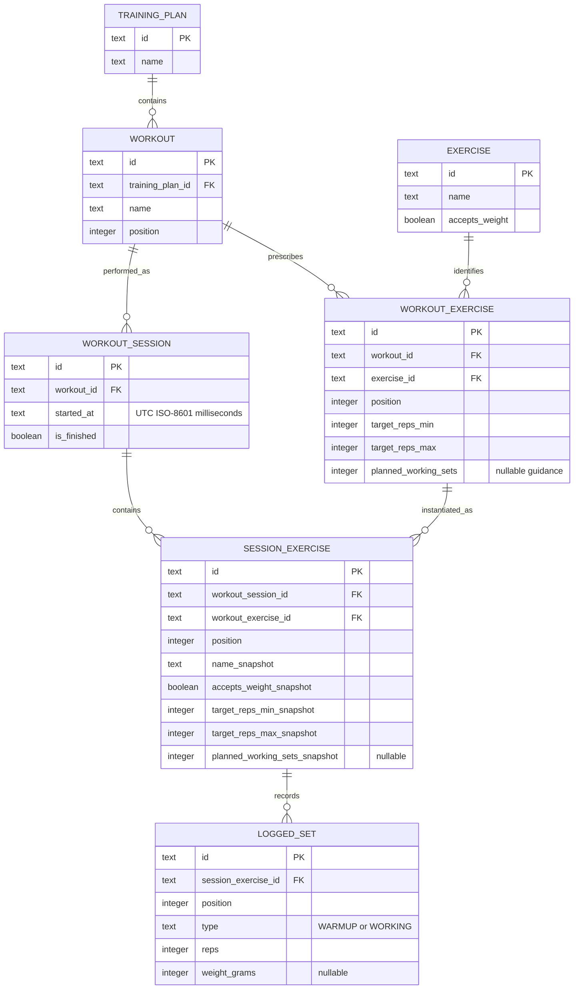

# Data model

There is no `completed_at`, equipment interpretation, or redundant
`session_exercise.exercise_id`. GraphQL derives exercise identity by joining
`workout_exercise`; snapshots preserve historical presentation/prescriptions.
Positions are zero-based. A session exercise's set type is stored explicitly,
not inferred later from its position.

Weighted exercises require non-negative integer grams; reps-only exercises
reject weights. The repository validates that rule against the session snapshot.
SQLite constraints enforce references, valid types, positive reps, non-negative
weights, and unique positions. Session deletion cascades to its exercises and sets.

`is_finished` persists completion. V002 marks legacy sessions finished and adds a
partial unique index allowing at most one ongoing (`is_finished = 0`) session.
Recording a new session's first set atomically finishes the previous ongoing
session. Explicit finish persists completion; editing past sets never reopens a
session. Drafts are browser-memory only and do not affect the ongoing session.
